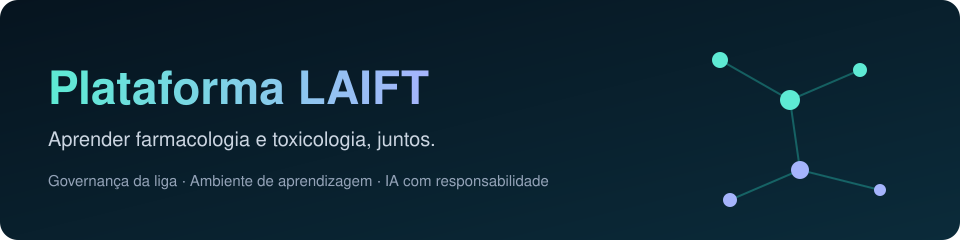
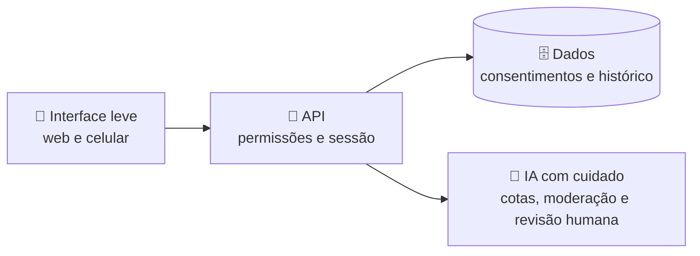

**A plataforma da LAIFT, Liga Acadêmica Interdisciplinar de Farmacologia e Toxicologia**

---

## ✨ O que é

Um só lugar para a vida da liga e para o estudo: **governança comunitária** (eventos, propostas com votação, tarefas, equipe e mensagens) e um **ambiente de aprendizagem** com simuladores, clínica virtual, laboratório e anatomia 3D.

## 🧭 Escolha a sua trilha

| Você é… | Comece por aqui |
|---|---|
| 🎒 **Estudante** | [🧪 Módulos de aprendizagem](#-mapa-de-módulos) |
| 🏛️ **Membro da liga** | [🤝 Vida da liga](#-vida-da-liga) |
| 🧑‍💻 **Curioso por como foi pensado** | [🧩 Como as peças se encaixam](#-como-as-peças-se-encaixam) |
| 🌐 **Quer conhecer ao vivo** | [laift.com.br](https://laift.com.br) |

## 🗺️ Mapa de módulos

Clique para abrir cada módulo.

🧬 <strong>Atlas 3D e Farmacocinética</strong>: explore o corpo em três dimensões

Navegue por estruturas anatômicas com conteúdo revisado e acompanhe, de forma visual, o caminho de um medicamento no organismo.

🏥 <strong>Clínica Virtual</strong>: plantão, prontuário e casos fictícios

Treine o raciocínio clínico com **pacientes virtuais** e um **preceptor com IA**, em casos **fictícios**, passando por plantão, avaliação prática e prontuário.

🔬 <strong>Laboratório Virtual e Estúdio Molecular</strong>: experimente sem riscos

Simule experimentos e visualize moléculas e espécies químicas, com um preceptor de laboratório para explicar o que está acontecendo.

💊 <strong>Quizzes de Farmacologia e de Toxicologia</strong>: aprenda jogando

Perguntas organizadas por tópico, com feedback imediato e um motor de quiz único para toda a plataforma.

📲 <strong>Presença por QR Code</strong>: check-in rápido em eventos

Credencial pessoal em QR Code para registrar presença, com terminal de leitura e emissão de crachás para a organização.

## 🤝 Vida da liga

- 📅 **Eventos** com inscrição
- 🗳️ **Propostas** com votação entre membros
- ✅ **Tarefas** colaborativas
- 👥 **Equipe** e perfis
- 💬 **Mensagens** protegidas

## 🧩 Como as peças se encaixam

🎛️ <strong>Decisões de projeto</strong> (o que foi pensado desde o começo)

- **Perfis e permissões:** visitante, membro e administrador, com cargos por capacidade; a conferência de quem pode o quê acontece no servidor, a cada ação.
- **Segurança e privacidade:** conteúdo externo tratado como texto, proteção contra abuso, sessões que podem ser revogadas, termos e privacidade versionados com aceite registrado.
- **IA responsável:** limites de uso, moderação, fila de revisão humana e conteúdo de usuários isolado das instruções do sistema.
- **Qualidade:** revisão editorial do conteúdo, testes automatizados e atenção à acessibilidade.

*Descrição do que foi projetado; não é certificação.*

## 🎮 Como experimentar

1. Acesse **[laift.com.br](https://laift.com.br)**.
2. Navegue pela área **Aprender** e escolha um módulo.
3. Quer uma **demonstração guiada**? Escreva para **dpires292@gmail.com**.

## 🌱 Para onde pode evoluir

Possibilidades em avaliação, sem prazo definido: novas formas de login, assistente com base de conhecimento ampliada, recomendações de estudo personalizadas e parcerias com outras ligas.

---

## Autoria e projeto

Criado por **Daniel Pires Francisco** (Daniel P Francisco), Presidente da LAIFT e graduando em Farmácia na UNINASSAU Salvador.

- Portfólio, currículo e serviços: https://dpflabs.com
- Plataforma LAIFT: https://laift.com.br
- Lattes: http://lattes.cnpq.br/5041510175000740

Conteúdo educativo. Os casos clínicos são fictícios e nada aqui substitui o acompanhamento de profissionais de saúde habilitados.
